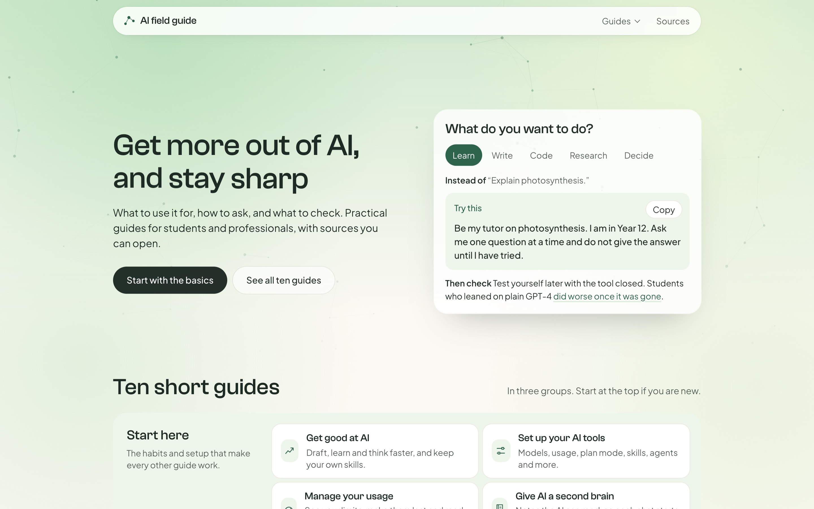

# AI field guide

Practical guides to using AI well, for students and professionals, with every claim sourced.

**Live:** https://musa-ai-field-guide.pages.dev



## What's in it

Eleven short guides in three groups:

| Start here | Build with AI | Use it responsibly |
| --- | --- | --- |
| Get good at AI | Code with AI | Use AI safely |
| Set up your AI tools | Hand work to agents | AI in cyber security |
| Manage your usage | Build websites with AI | Stand out at work |
| Give AI a second brain | | AI in your field |
| Teach AI with skills | | |

Each guide runs the same way: what AI is good for, how to do it, where to be careful, and a "Behind this guide" area with notes, evidence, terms and sources.

## How the sources are handled

All 85 sources are on one [Sources page](https://musa-ai-field-guide.pages.dev/sources), each labelled by how far it was checked: read on the source page, partly read (often the abstract), or from a search summary only. Studies of where AI helps were picked on purpose, and the page says so. Research notes are in [`research/ai-research.md`](research/ai-research.md), and the November 2026 deep research, including what was rejected, is in [`research/deep-research-nov-2026.md`](research/deep-research-nov-2026.md).

## Built with

Astro 7, React islands, Radix, plain CSS. Hosted free on Cloudflare Pages.

## Run it locally

Needs Node 22 or newer.

```bash
npm install
npm run dev      # http://localhost:4321
npm run check    # type check, then build
```

## Where things live

- `src/data/guide.ts`: every guide's content and claims.
- `src/data/panels.ts`: the three groups, card blurbs and icons.
- `src/data/playbooks.ts`: prompts, habits and the home page's "where AI has helped" figures.
- `src/components/`: the constellation background, the prompt picker, citations and the evidence filter.
- `tools/brain-graph.py`: redraws the second-brain graph from a notes vault, with note names left out.

## Deploys

Merging into `master` deploys to Cloudflare Pages. Every other branch gets its own preview address.
